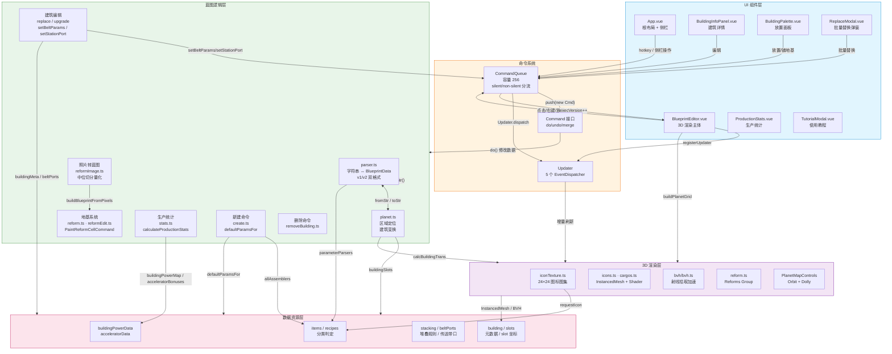

# 架构文档 — dsp_blueprint_editor

## 1. 系统架构高层描述

本项目是一个纯前端单页应用（Vue 3 + Three.js），用于在 3D 星球网格上可视化、编辑、批量替换、撤销/重做戴森球计划蓝图。整体采用**解析与渲染解耦**的分层架构：

- **纯逻辑层**：`src/blueprint/` + `src/data/` 为纯 TypeScript 模块，无 Three.js/Vue 依赖，可独立在 Node.js 中运行（CLI + Jest 测试）。
- **响应式驱动的渲染层**：`BlueprintEditor.vue` 用 `computed` 监听 `commandQueue.execVersion`，命令执行后整场景重建；`Updater` 事件通道允许增量刷新（图标/物流塔面板等）。
- **字节级 round-trip**：v2 body 对未知扩展字段以"原样保留 + 重新写出"方式实现，确保再导出与原蓝图逐字节一致。

### 1.1 架构分层

```
┌───────────────────────────────────────────────────────────┐
│                     UI 组件层 (Vue 3)                      │
│  App.vue · BlueprintEditor.vue · BuildingInfoPanel.vue     │
│  StationInfo.vue · SpitterInfo.vue · ReplaceModal.vue     │
│  ProductionStats.vue · BuildingPalette.vue · TutorialModal │
└───────────────────────┬───────────────────────────────────┘
                        │  provide/inject + hotkey
┌───────────────────────▼───────────────────────────────────┐
│                 命令系统 (Command Queue)                    │
│  command.ts · CommandQueue · Updater · EventDispatcher    │
│  256 容量撤销栈 · merge 合并 · silent / non-silent 分流    │
└───────────────────────┬───────────────────────────────────┘
                        │ do() / undo()
┌───────────────────────▼───────────────────────────────────┐
│                 蓝图逻辑层 (blueprint/)                     │
│  parser.ts · planet.ts · area.ts · sorter.ts · beltLine   │
│  create.ts · removeBuilding.ts · reformEdit.ts · stats.ts  │
│  replace.ts · upgrade.ts · defaultParams.ts · reformImage │
└──────────┬──────────────────────────────┬─────────────────┘
           │                              │
┌──────────▼──────────┐        ┌───────────▼─────────────┐
│  数据资源层 (data/)  │        │  3D 渲染层 (Three.js)    │
│  items / recipes    │        │  iconTexture · icons     │
│  building / slots   │        │  cargos · bvh · planet   │
│  stacking / ports   │        │  PlanetMapControls       │
│  power / accelerator│        │  Reform 3D 渲染          │
└─────────────────────┘        └──────────────────────────┘
```

### 1.2 核心架构特点

| 特点 | 说明 | 代码位置 |
| --- | --- | --- |
| 解析与渲染解耦 | `parser.ts` 无 Three.js 依赖，Node CLI 与 Jest 可直接导入 | `src/blueprint/parser.ts` |
| 响应式驱动重建 | `computed(b)` 依赖 `execVersion`，非 silent 命令后触发整场景重建 | `src/components/BlueprintEditor.vue` |
| 增量刷新通道 | `Updater` 5 个 EventDispatcher，避免整场景重建 | `src/command.ts` |
| 字节级 round-trip | `extraBytes` / `tailExtraBytes` / `v2ExtraPose` 原样保留再写出 | `src/blueprint/parser.ts` `importBuildingV2` / `exportBuildingV2` |
| PWA + 离线 | service worker，主题色 `#000000` | `vue.config.js` |

### 1.3 数据流

```
蓝图字符串 → fromStr() → BlueprintData
                              │
                              ▼
                      findPosForAreas() → PositionedBlueprint（区域定位）
                              │
                              ▼
                      calcBuildingTrans() → 每个建筑两个端点的 4×4 世界变换
                              │
                              ▼
                      buildBuildings() → InstancedMesh 集合
                              │
                              ▼
                      buildBVH() → 层次包围盒
                              │
                              ▼
                   BlueprintEditor 挂载 Three.js Scene
```

编辑操作的逆向数据流：

```
用户操作 → CommandQueue.push(new XxxCommand(bp, ...))
            │ do() 改 BlueprintData
            │ Updater.dispatch() 通知增量刷新
            │ execVersion++ / stateVersion++
            ▼
BlueprintEditor.computed(b) 重新构建场景（若非 silent）
App.vue.watchEffect(codeExpired = true)
            │
            ▼
用户点击"复制" → toStr(bp) → 导出蓝图字符串
```

---

## 2. 系统架构 Mermaid Flowchart

以下流程图展示了项目的主要组件及其依赖流向。



### 2.1 渲染重建 vs 增量刷新

```mermaid
flowchart LR
    subgraph CommandExecute["命令执行"]
        A[CommandQueue.push] --> B{silent?}
    end
    B -->|"yes (改图标/颜色/文字)"| C[stateVersion++]
    C --> D[Updater.dispatch<br/>增量刷新]
    B -->|"no (改几何/拓扑)"| E[stateVersion++<br/>execVersion++]
    E --> F[BlueprintEditor<br/>computed(b) 触发重建]

    subgraph Affected["受影响层"]
        D --> D1["Icons / 面板数据<br/>局部更新"]
        F --> F1["清空 AllBuildings<br/>dispose resources<br/>重建场景 + BVH"]
    end
```

### 2.2 核心依赖关系（文件级）

```
main.ts → App.vue → BlueprintEditor.vue (动态组件)
                      │
                      ├── planet.ts (区域定位)
                      ├── parser.ts (解析)
                      ├── bvh.ts (拾取)
                      ├── iconTexture.ts (图集)
                      ├── cargos.ts (货物动画)
                      └── command.ts (命令系统, provide 注入)

command.ts → blueprint/* (命令实现)
             │
             ├── parser.ts (操作 BlueprintData)
             ├── data/building.ts (buildingMeta)
             ├── data/buildingSlots.ts
             └── data/beltPorts.ts

blueprint/parser.ts
  ├── data/items.ts (allAssemblers → parameterParsers 注册)
  └── data/types.ts (类型定义)

blueprint/stats.ts → data/buildingPowerData.ts + data/acceleratorData.ts
blueprint/defaultParams.ts → data/items.ts (allAssemblers)
blueprint/reformImage.ts → blueprint/reformEdit.ts
blueprint/create.ts → blueprint/defaultParams.ts
blueprint/upgrade.ts → data/items.ts (itemsMap)
blueprint/beltLine.ts → data/beltPorts.ts + data/buildingSlots.ts + data/stacking.ts
blueprint/sorter.ts → data/buildingSlots.ts + data/stacking.ts + data/beltPorts.ts
```

---

## 3. 技术栈

| 分类 | 技术 | 版本 | 用途 |
| --- | --- | --- | --- |
| 前端框架 | Vue | ^3.2.13 | Composition API + `<script setup>` |
| 3D 渲染 | Three.js | ^0.160.0 | WebGL 场景，通过 `three/src/Three.js` 别名直接引用源码 |
| 蓝图压缩 | pako | ^2.0.4 | gzip 解压/压缩蓝图二进制体 |
| 国际化 | vue-i18n | ^9.1.0 | 中英双语 |
| Markdown 渲染 | marked | ^18.1.1 | 教程弹窗 |
| XSS 防护 | DOMPurify | ^3.4.17 | 教程弹窗 HTML 净化 |
| 语言 | TypeScript | ^5.1.3 | `strict: true` |
| 构建 | Vue CLI | ~5.0.1 | webpack 5 |
| 测试 | Jest | ^29 + ts-jest | 单元测试 |
| 格式化 | Prettier | - | `yarn format` |

参见 [getting-started.md](getting-started.md) 了解环境搭建与运行命令。
