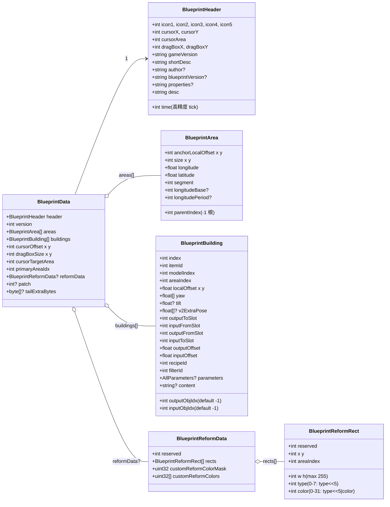
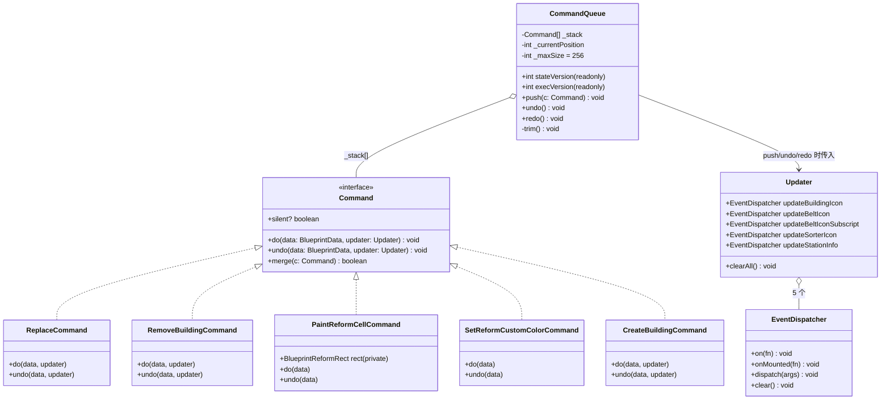

# 类图 — 核心数据结构与命令系统

## 1. 蓝图核心数据结构

### 关键说明

- `BlueprintBuilding.outputObjIdx = -1` 表示未连接，分拣器/传送带/建筑的连接关系全部靠这两个字段串联。
- `v2ExtraPose` 仅分拣器有，7 个 float（pose0, tip.x/y/z, yaw0, tilt, yaw1）。解析器原样保留，`pose[4]` 必须等于 `yaw[0]`，否则游戏报"分拣器角度偏移"（见 `blueprint/parser.ts` `importBuildingV2`）。
- `color` 字段 5-bit：0..15 游戏内置色，16..31 自定义色槽。`customReformColorMask` 的位 i 表示自定义槽 i 是否已设置。

---

## 2. 命令系统

### 不变量

| 不变量 | 原因 |
| --- | --- |
| `silent=true` 命令不触发 `execVersion++` | 图标/颜色/文字改动不需要重几何 |
| silent 命令仍触发 `stateVersion++` | App.vue 需要 `codeExpired = true` 让蓝图字符串过期 |
| undo/redo 也要增 `stateVersion` | 撤销后蓝图字符串也变了 |
| undo/redo 非 silent 命令也要增 `execVersion` | 撤销后几何也要重建 |

参见 `src/command.ts` CommandQueue.push/undo/redo 实现。

---

## 3. 参数类型层次

```mermaid
classDiagram
    direction TB

    class AllParameters {
        <<union>>
    }

    class StationParameters {
        +StorageItem[] storage (maxItemKind)
        +StationSlot[] slots (12)
        +int workEnergyPerTick
        +int tripRangeOfDrones
        +int tripRangeOfShips
        +boolean includeOrbitCollector
        +int warpEnableDistance
        +boolean warperNecessary
    }

    class SplitterParameters {
        +boolean[4] priority
        +int[2] extra
    }

    class AssembleParamerters {
        +AcceleratorMode acceleratorMode
    }

    class LabParamerters {
        +ResearchMode researchMode
        +AcceleratorMode acceleratorMode
    }

    class BeltParameters {
        +int iconId
        +int count
    }

    class InserterParameters {
        +int length
    }

    class StorageParameters {
        +int automationLimit
        +StorageType type
        +int[]? grids
    }

    class MonitorParameters {
        +int tone
        +int volume
        +int pitch
        +boolean repeat
        +int length
        +float[] falloffRadius
    }

    AllParameters <|-- StationParameters
    AllParameters <|-- SplitterParameters
    AllParameters <|-- AssembleParamerters
    AllParameters <|-- LabParamerters
    AllParameters <|-- BeltParameters
    AllParameters <|-- InserterParameters
    AllParameters <|-- StorageParameters
    AllParameters <|-- MonitorParameters
    AllParameters <|-- TankParameters
    AllParameters <|-- BattleBaseParameters
    AllParameters <|-- DispenserParameters
    AllParameters <|-- UnknownParamerters
```

