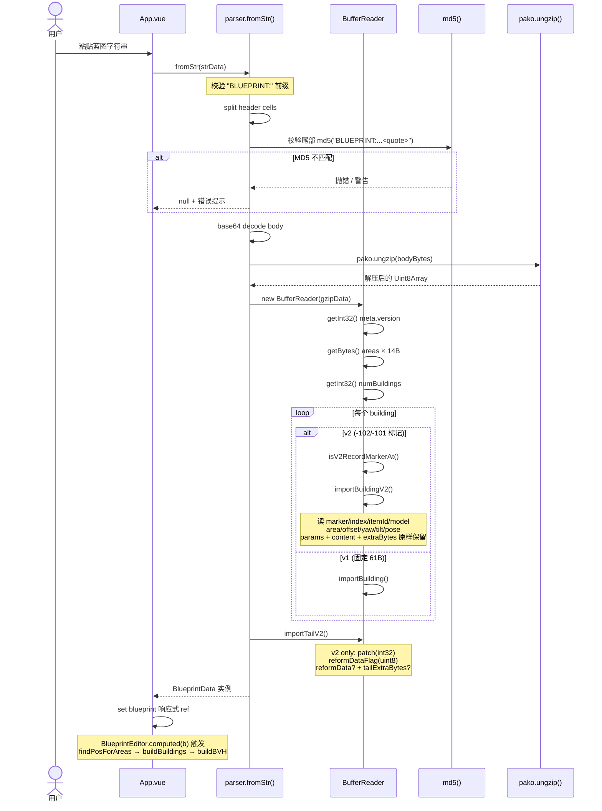
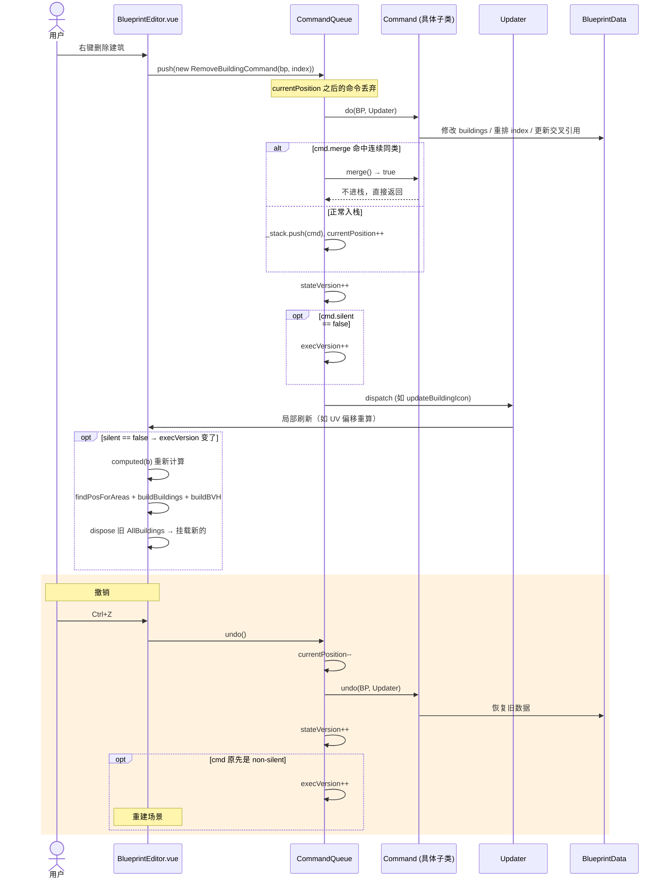
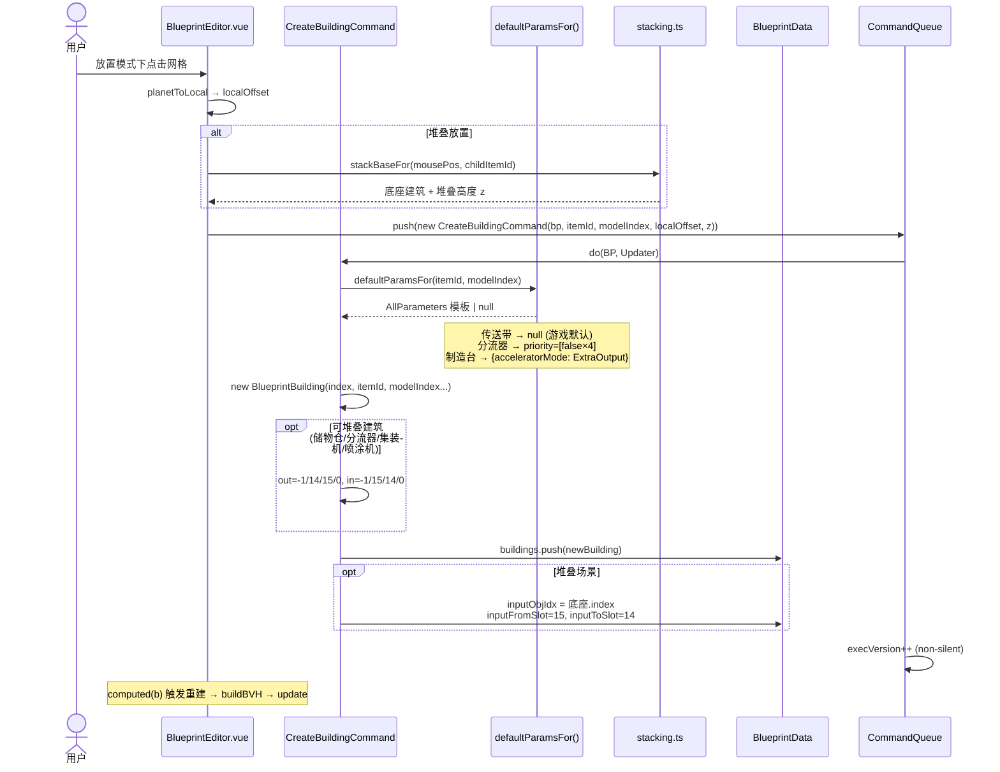
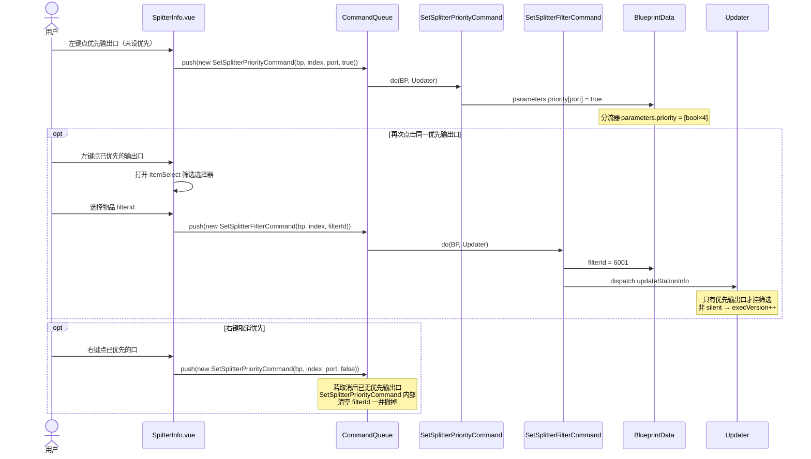

# 时序图 — 关键工作流

## 1. 蓝图解析流程（fromStr）

用户粘贴蓝图字符串到右侧文本框，App.vue 调用 `parser.fromStr()` 解析。



## 2. 撤销重做流程



## 3. 照片转蓝图流程

用户点击 BuildingPalette 的"导入图片"按钮，上传图片生成像素地基蓝图。

```mermaid
sequenceDiagram
    actor User as 用户
    participant Palette as BuildingPalette.vue
    participant Img2BP as reformImage.ts
    participant Canvas as HTMLCanvasElement
    participant Quantize as medianCutQuantize()
    participant Build as buildBlueprintFromPixels()
    participant Create as createEmptyBlueprint()

    User->>Palette: 点击"导入图片" → 选文件
    Palette->>Img2BP: photoToBlueprint(Blob)

    Img2BP->>Img2BP: loadPhotoImage(Blob)
    Img2BP->>Canvas: scale = 160 / img.height
    Note over Canvas: cols = min(1000, round(w × scale))
    Canvas->>Canvas: translate(w, h); scale(-1, -1)
    Note over Canvas: 整体 180° 旋转 = 上下+左右镜像
    Canvas->>Img2BP: ImageData RGBA

    Img2BP->>Quantize: medianCutQuantize(unique, freqs, 16)
    Note over Quantize: 按频率加权中位切分<br/>每次切通道范围最大的 box<br/>每盒取加权平均色
    Quantize-->>Img2BP: ≤16 种代表色 RGB[]

    Img2BP->>Build: buildBlueprintFromPixels(pixels, w, h)
    Build->>Build: 调色板 = 内置 16 色 + 代表色 16 种
    loop 每格
        Build->>Build: nearestIndex(palette, pixel) → slotsPerCell
    end

    Build->>Build: buildRectsFromSlots()
    Note over Build: 行内 run-length 合并 w≤255<br/>纵向同 x/w/slot 合并 h≤255

    Build->>Create: createEmptyBlueprint()
    Create-->>Build: 空 BlueprintData (根区域 10×161)
    Build->>Build: 设置 areas[0].size = {w, h}
    Build->>Build: 写入 reformData.rects + customReformColors + mask

    Build-->>Img2BP: BlueprintData（像素地基蓝图）
    Img2BP-->>Palette: 返回 BlueprintData
    Palette->>Palette: 导入到当前编辑蓝图
```

## 4. 新建建筑命令（CreateBuildingCommand）

用户在放置模式下点击网格，编辑器用 defaultParamsFor 填参数，落位后完整索引管理。



## 5. 用户点击分流器设置优先输出


