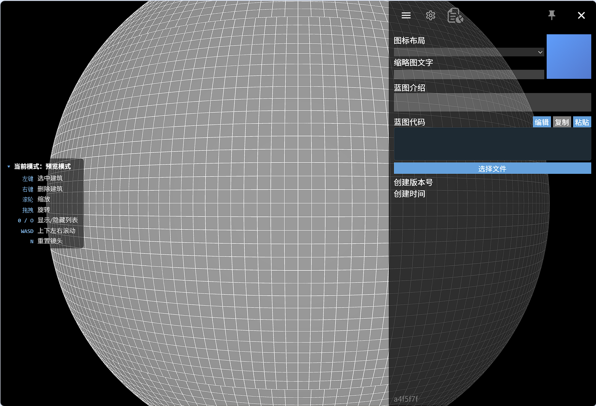
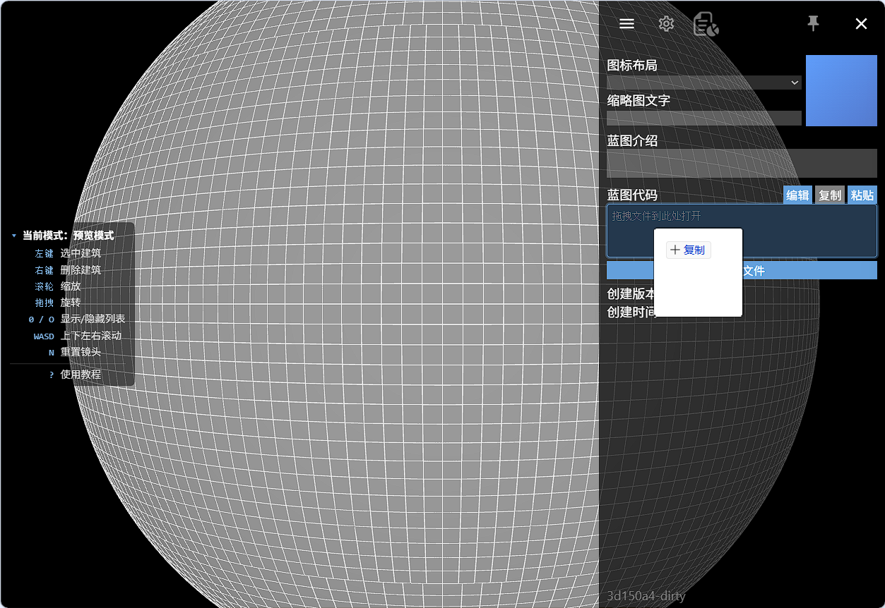
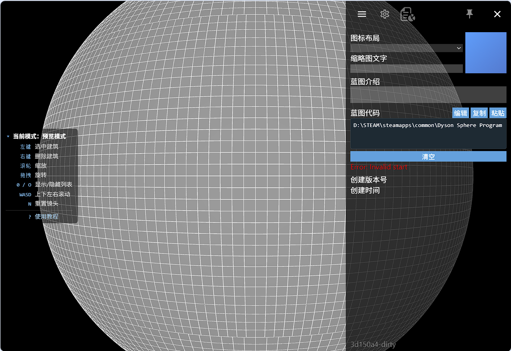
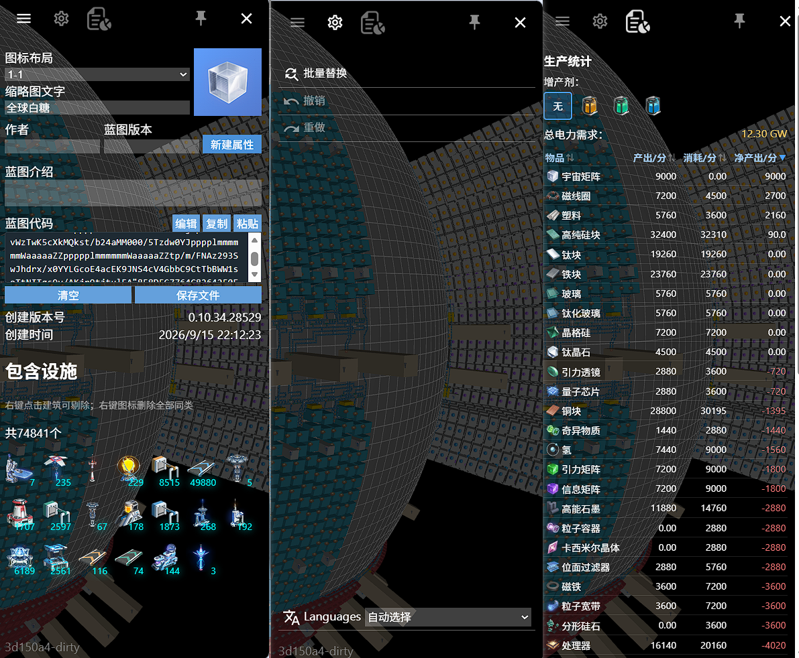
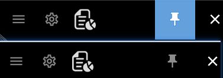

# DSP 蓝图编辑器 · 功能说明

> 本文档只描述 **这个工具能做什么、怎么用**，不涉及任何代码、框架、目录结构或实现细节。
> 文中标注了需要配图的位置（📷），每处都写明了图片应展示的内容；图片请直接替换对应占位行。

**文档版本**：v1.0
**对应程序版本**：2.0.5.3

---

## 目录

1. [这是什么](#1-这是什么)
2. [快速上手](#2-快速上手)
3. [界面总览](#3-界面总览)
4. [3D 预览与视角操作](#4-3d-预览与视角操作)
5. [蓝图文件管理](#5-蓝图文件管理)
6. [蓝图信息编辑](#6-蓝图信息编辑)
7. [蓝图图标编辑](#7-蓝图图标编辑)
8. [建筑编辑模式](#8-建筑编辑模式)
9. [底部建筑面板](#9-底部建筑面板)
10. [放置、堆叠、传送带与分拣器](#10-放置堆叠传送带与分拣器)
11. [建筑参数面板](#11-建筑参数面板)
12. [地基与照片转蓝图](#12-地基与照片转蓝图)
13. [建筑总览](#13-建筑总览)
14. [批量替换与升降级](#14-批量替换与升降级)
15. [撤销与重做](#15-撤销与重做)
16. [生产统计](#16-生产统计)
17. [保存与导出](#17-保存与导出)
18. [语言与离线使用](#18-语言与离线使用)
19. [快捷键总表](#19-快捷键总表)
20. [图片清单](#20-图片清单)

---

## 1. 这是什么

DSP 蓝图编辑器是一个**运行在浏览器里的《戴森球计划》蓝图查看与编辑工具**。它直接读取游戏导出的蓝图代码，在网页里把整张蓝图还原成一个**可旋转、可缩放的 3D 星球沙盘**，并允许你像在游戏里一样继续建造、拆改、调参数，最后再导出成游戏能识别的蓝图代码贴回游戏。

### 核心能力一览

| 能力 | 说明 |
| --- | --- |
| 蓝图解析与导出 | 读取游戏蓝图代码 / `.txt` 蓝图文件，原样还原并重新生成可用的蓝图代码 |
| 3D 可视化 | 在球面上还原建筑、传送带、分拣器、图标、堆叠层与地基 |
| 建筑编辑 | 放置、删除、旋转、切换形态、堆叠、自由放置 |
| 传送带与分拣器 | 两点成线自动铺带，支持三种路径走法；分拣器两点架接 |
| 参数编辑 | 配方、分拣器过滤、传送带图标与数量、物流站全部参数、研究站模式、信标文本等 |
| 地基绘制 | 逐格铺/涂地基，32 个颜色槽（16 内置 + 16 自定义） |
| 照片转蓝图 | 把一张图片直接转成地基图案 |
| 批量操作 | 批量替换配方/筛选/栏位/图标，批量升降建筑等级 |
| 生产统计 | 按配方计算每分钟产出、消耗、净产出与总电力需求 |
| 撤销重做 | 所有编辑操作均可撤销/重做 |
| 多语言与离线 | 中文/英文（含自动），支持安装为离线可用的网页应用 |

📷 **图 1-1**：工具主界面全景（预览模式）
**图片说明**：截取浏览器中打开一张已有蓝图的完整界面——中间是带建筑与传送带的 3D 星球俯视图，右侧为展开的侧栏，左侧显示快捷键提示条。用于让读者第一眼建立整体印象。



---

## 2. 快速上手

### 2.1 只想看看别人的蓝图

1. 从游戏复制蓝图代码，或拿到一个蓝图 `.txt` 文件。
2. 在右侧**侧栏 → 蓝图代码**输入框中**粘贴**代码，或把 `.txt` 文件**拖到输入框上**。
3. 解析成功后，3D 视图立即显示整张蓝图。
4. 用鼠标中键拖拽旋转、滚轮缩放，左键点击任意建筑查看它的详细信息。

### 2.2 想改一张蓝图

1. 先按上面的步骤载入蓝图。
2. 点击**蓝图代码**区的「编辑」按钮进入**编辑模式**。
3. 底部出现**建筑面板**，按 `1`~`9` 选分类，按 `F1`~`F12` 选建筑，在星球上点击放置。
4. 改完后点击「保存」，3D 视图切回预览，蓝图代码自动刷新为最新内容。
5. 点「复制」把代码复制回游戏，或点「保存文件」下载 `.txt`。

### 2.3 想从零画一张

不载入任何蓝图，直接点「编辑」即可——工具会自动创建一张空白蓝图（赤道附近一块空白起步区域），然后从空地图开始铺设。

📷 **图 2-1**：把蓝图 `.txt` 文件拖拽到代码框上的悬停高亮效果
**图片说明**：截取代码输入框在拖拽文件悬停时的蓝色描边/高亮状态，并用鼠标指针示意正在拖入文件。

```

```

📷 **图 2-2**：载入失败时的错误提示
**图片说明**：截取代码框下方红色的错误提示文字（如校验失败/格式错误），用于说明解析失败的反馈方式。

```

```

---

## 3. 界面总览

界面由四块区域组成：

| 区域 | 位置 | 作用 |
| --- | --- | --- |
| **3D 视图** | 占满整个窗口 | 星球沙盘，展示与操作建筑 |
| **侧栏** | 右侧，可收起 | 蓝图信息、操作、统计三个标签页 |
| **建筑面板** | 底部 | 仅在编辑模式下出现，用于挑选建筑 |
| **快捷键提示条** | 左侧中部 | 跟随当前模式显示可用按键 |

### 3.1 侧栏

侧栏顶部有三个标签页图标：

- **信息页**：蓝图名称、图标、作者、蓝图版本、自定义属性、介绍、蓝图代码、建筑详情或建筑总览。
- **操作页**：批量替换、撤销、重做、语言切换。
- **统计页**：生产统计表。

侧栏的展开/收起方式：

- 点击右上角的**菜单按钮**展开或收起。
- 按 `0` 或 `O` 键快速开关。
- 点击右上角的**图钉按钮**可以「固定」侧栏：固定后点击菜单按钮不会简单收起，而是解除固定并收起，避免编辑时误触遮挡。

📷 **图 3-1**：侧栏三个标签页（信息 / 操作 / 统计）
**图片说明**：建议做成三联图或并排截图，分别展示信息页、操作页、统计页的内容，帮助读者理解侧栏结构。

```

```

📷 **图 3-2**：侧栏固定按钮的两种状态
**图片说明**：截取右上角图钉按钮未固定（半透明）与已固定（蓝色高亮）两种状态的对比。

```

```

---

## 4. 3D 预览与视角操作

3D 视图把蓝图还原成一个球面沙盘，可以看到：

- **星球网格**：球面上的经纬网格线，帮助判断方位与距离。
- **建筑本体**：按建筑类型着色的立体模型。
- **建筑图标**：每个建筑上方悬浮的图标——若该建筑设置了配方，显示**配方图标**；否则显示建筑自身图标。研究站为「矩阵合成」模式且已选配方时显示配方图标。
- **下标数字**：分拣器下方显示分拣数量，传送带显示货物数量（数量超过 10 万时以 `k` 简写）。
- **传送带与分拣器上的货物**：小方块沿路径持续流动，用于直观看出物流走向（纯视觉动画，不代表实际吞吐计算）。
- **地基**：已铺设的地基以带纹理的贴片显示，颜色按所选颜色槽呈现。
- **选中高亮**：点击建筑后出现半透明蓝色高亮框。
- **放置预览**：编辑模式下鼠标位置的半透明绿色预览框。

### 视角操作

| 操作 | 效果 |
| --- | --- |
| 鼠标中键拖拽 | 旋转星球 |
| 鼠标滚轮 | 缩放（限制在一个合理范围内，不会穿进球体或飞得太远） |
| `W` / `S` | 视角上下旋转 |
| `A` / `D` | 视角左右旋转 |
| `N` | 重置镜头，回到初始俯视角度 |
| 双指捏合 | 触屏设备上缩放并旋转 |

> 说明：滚轮与中键拖拽是最常用的两种操作；`WASD` 与 `N` 提供了纯键盘的替代方案。当前版本不提供相机自动飞向某个建筑的功能，选中建筑以高亮框提示为准。

📷 **图 4-1**：3D 视图中的建筑、图标、下标与选中高亮
**图片说明**：截取一张有若干建筑和传送带的局部特写，要求画面中同时能看到：带配方的建筑显示配方图标、分拣器/传送带下方的数字下标、以及一个被蓝色框选中的建筑。

```

```

📷 **图 4-2**：传送带上的货物流动
**图片说明**：截取传送带局部放大图，展示带上的货物方块沿带移动的画面（可做两张不同时刻的对比，或用箭头标注流动方向）。

```

```

📷 **图 4-3**：地基颜色与纹理效果
**图片说明**：截取铺有地基的区域，展示不同颜色/图案的地基贴片效果。

```

```

---

## 5. 蓝图文件管理

### 5.1 载入

支持四种载入方式，效果完全相同：

1. **粘贴**：把代码粘贴进代码框。
2. **粘贴按钮**：点击「粘贴」，从系统剪贴板读取。
3. **选择文件**：点击「选择文件」挑选本地的 `.txt` 蓝图文件。
4. **拖拽**：把 `.txt` 文件拖到代码框上放开。

只接受 `.txt` 文件或纯文本内容，其他类型会提示「仅支持 .txt 文件」。

### 5.2 清空

载入蓝图后，按钮会变成「清空」，点击后回到未载入状态。

### 5.3 复制与导出

- **复制**：把当前蓝图代码复制到剪贴板，可直接粘回游戏。
- **保存文件**：下载为 `.txt` 文件，文件名默认取**蓝图名称**。

### 5.4 代码框的智能显示

- 蓝图代码很长时，代码框只显示**开头和结尾两段**（中间以省略号代替），避免界面卡顿。
- 一旦你修改了蓝图（编辑建筑、改参数等），代码框会显示为「已过期」的占位提示，**点击代码框即可重新生成最新代码**，复制/保存时也会自动使用最新内容，不会出现「改完却复制了旧代码」的情况。
- 载入的新蓝图若与上一张不同，镜头会自动重置到初始视角。

📷 **图 5-1**：蓝图代码区（载入态、含复制/粘贴/保存文件/清空按钮）
**图片说明**：截取侧栏信息页下方的「蓝图代码」整块区域，包括输入框、按钮行与「保存文件」链接。

```

```

📷 **图 5-2**：代码过期提示状态
**图片说明**：截取编辑过蓝图之后代码框显示的过期占位文本（如 `BLUEPRINT:...`），用于说明「点击即刷新」的行为。

```

```

---

## 6. 蓝图信息编辑

侧栏信息页可以修改蓝图自身的元信息：

| 字段 | 说明 |
| --- | --- |
| **图标布局** | 蓝图图标采用哪种排布样式（无 / 1-1 / 1-2 / 2-1…5-2 等共 15 种）。 |
| **缩略图文字** | 蓝图在游戏内显示的名称，也作为导出文件的文件名。 |
| **作者** | 蓝图作者署名。 |
| **蓝图版本** | 自定义版本号。 |
| **自定义属性** | 名称 : 内容 的键值对列表，可逐条新建、编辑、删除；在游戏内以条目形式展示。 |
| **蓝图介绍** | 多行描述文本。 |
| **创建版本号 / 创建时间** | 只读，显示该蓝图原本由哪个游戏版本、在什么时间创建。 |

📷 **图 6-1**：信息页的元信息编辑区
**图片说明**：截取信息页上半部分，包含图标布局下拉框、缩略图文字输入框、图标预览、作者、蓝图版本，以及「新建属性」按钮与属性列表。

```

```

📷 **图 6-2**：自定义属性的条目样式
**图片说明**：截取一条属性的完整外观：左侧切角样式的「属性名」标签、右侧「属性内容」输入框与红色删除按钮。

```

```

---

## 7. 蓝图图标编辑

蓝图封面由若干个图标槽组成，不同「图标布局」提供不同数量的槽位（无、1~2 槽、2~5 槽、3~4 槽、4~2 槽、5~2 槽）。

- 点击任意图标槽即可打开**图标选择器**。
- 图标选择器按分类分页浏览：**物品**、**建筑**、**配方**、**信号**、**科技**、**升级 I**、**升级 II**。
- 选中后立即回填到该槽位；也可以选择「清除」把该槽置空。
- 空槽在界面上以虚线框加「+」显示，方便识别。

📷 **图 7-1**：蓝图图标的多槽布局与空槽提示
**图片说明**：截取图标预览区，展示一种多槽布局（如 2-3 或 3-3），其中至少一个槽为空并显示虚线框与「+」，用于说明可点击编辑。

```

```

📷 **图 7-2**：图标选择器
**图片说明**：截取弹出的图标选择器，要求能看到顶部分类页签（物品/建筑/配方/信号/科技…）与按网格排列的图标列表。

```

```

---

## 8. 建筑编辑模式

工具分两个大模式：

- **预览模式**（默认）：只看不改，可以选中和删除建筑。
- **编辑模式**：可以放置、修改、铺设地基。进入方式为点击蓝图代码区的「编辑」，退出为点击「保存」。

编辑模式内部又细分为四种状态，界面颜色与快捷键提示条会随之变化：

| 状态 | 进入方式 | 能做什么 | 网格线颜色 |
| --- | --- | --- | --- |
| **空闲** | 默认 / `Esc` | 选分类与建筑 | 绿色 |
| **放置** | 从建筑面板选中一个建筑 | 放置、旋转、堆叠建筑 | 绿色 |
| **删除** | 按 `X` | 点击删除建筑 | 红色 |
| **地基** | 在建筑面板第 9 类选中「地基」 | 逐格铺/涂地基 | 蓝色 |

退出当前状态的方式：按 `Esc`，或在空闲以外的状态下点击右键。

📷 **图 8-1**：编辑模式下的放置预览与绿色网格
**图片说明**：截取编辑模式放置状态，画面中需同时出现：星球上跟随鼠标的半透明绿色预览框、绿色网格线、以及底部已展开的建筑面板。

```

```

📷 **图 8-2**：删除模式（红色网格）与地基模式（蓝色网格）对比
**图片说明**：做成左右对比图，分别截取删除模式与地基模式下网格线的颜色差异与快捷键提示条内容。

```

```

---

## 9. 底部建筑面板

建筑面板只在编辑模式下出现，进入编辑时默认折叠。

面板分两行：

- **上行 — 建筑按钮**：当前分类下的所有建筑，按钮上标有对应的 `F1`~`F12` 快捷键。重复点击已选中的建筑可取消选择；尚未支持放置的建筑会显示为半透明，鼠标悬停提示「暂不支持」。
- **下行 — 分类按钮**：共 9 类，标有 `1`~`9`。

### 九个分类

| 键 | 分类 | 主要建筑 |
| --- | --- | --- |
| `1` | 电力类 | 电力感应塔、无线输电塔、卫星配电站、风力涡轮机、火力发电厂、太阳能板、地热发电站、微型聚变发电站、蓄电器 |
| `2` | 矿产类 | 采矿机、大型采矿机、抽水站、原油萃取站 |
| `3` | 物流类 | 三档传送带、四档分拣器、四向分流器、流速器、喷涂机 |
| `4` | 仓储类 | 小型储物仓、大型储物仓、储液罐 |
| `5` | 生产类 | 电弧熔炉、位面熔炉、制造台 Mk.I~III、原油精炼厂、化工厂、化工厂 Mk.II、分馏塔、微型粒子对撞机 |
| `6` | 物流塔类 | 物流配送器、自动集装机、物流运输站、星际物流运输站、能量枢纽 |
| `7` | 防御类 | 高斯机枪塔、导弹防御塔、聚爆加农炮、高频激光塔、磁化电浆炮、战场分析基站、地面电浆炮、干扰塔、护盾发生器 |
| `8` | 戴森球类 | 矩阵研究站、电磁轨道弹射器、射线接收站、垂直发射井、人造恒星、矩阵研究站 Mk.II、熔炉 Mk.III、制造台 Mk.IV |
| `9` | 地基与信标 | 全息信标、地基 |

选中第 9 类时，面板上会额外出现两个按钮：**「导入照片」** 与 **「RGBA 上色」**。

📷 **图 9-1**：展开的底部建筑面板
**图片说明**：截取展开状态的面板，要求能看到上行建筑图标行（带 F 编号、含一个半透明禁用项）、下行 1~9 分类行，以及第 9 类被选中时出现的「导入照片 / RGBA 上色」两个按钮。

```

```

---

## 10. 放置、堆叠、传送带与分拣器

### 10.1 普通建筑放置

在建筑面板选中建筑后，3D 视图中跟随鼠标出现预览框，左键点击即放置。放置前可以：

- 按 `R` **旋转 90°**（0°/90°/180°/270° 循环）。
- 按住 `Shift` **自由放置**（不吸附整格，可以放在格子中间）。
- 对有四向分流器这类**多种形态**的建筑，按 `R` 循环切换形态（十字形/一字形/十字形加强）。
- 按住 `Shift` 再按 `R`，即使是变形建筑也会强制旋转 90°。

### 10.2 堆叠

可堆叠的建筑（如储物仓等）在已有同类底座上再次放置时，会**自动叠加上去**，高度逐层递增，并自动记录上下层之间的连接关系（底座顶面 15 号口 ↔ 上层底面 14 号口）。

- 支持"同类自叠"的建筑：四向分流器、自动集装机、喷涂机、储物仓（小/大）、储液罐、矩阵研究站（Mk.I/Mk.II 可交叉）；每种建筑的一层高度固定（分流器/集装机/喷涂机/小箱子 = 2 格，大箱子/储液罐/研究站 = 3 格）。
- 支持"底座上放另一类"的组合：分流器上叠小箱子、箱子上叠箱子或物流配送器、战场分析基站上叠大型储物仓（会自动把箱子转到与底座长边对齐的朝向）。
- 部分建筑（如物流配送器）**必须放在底座上**，单独放置会被拒绝。
- 放不下的组合（游戏不接受）不会生效，避免导出后游戏报错。

### 10.3 传送带

在放置状态下，分两次点击确定起点 `A` 与终点 `B`，工具会自动生成一整条传送带（不是一格一格点）。

- 按 `R` 循环切换**路径走法**：
  - **先纬后经**（latFirst）——先沿纬线走，再沿经线走，阶梯状；
  - **先经后纬**（lonFirst）——先沿经线走，再沿纬线走；
  - **直线**（straight）——在球面上走一条最短的近似直线。
- 起点确定后，按**右键**可取消已选的起点 `A`。

**传送带与建筑的两种关系**：

- **串联（带接建筑为端点）**：`A` / `B` 点落在建筑的口上时，这条带就以该口为端点——
  - 起点落在口上 = **取出**（带从建筑取货，沿口法线离开）；
  - 终点落在口上 = **送入**（带把货送进建筑，沿口法线反向进入）；
  - 带端会精确贴在口上（口位置不在整格上，工具按游戏写法记录），接到物流站口时站上该口的方向会自动变成「出塔 / 入塔」（见 11.2）。
  - 口表覆盖：四向分流器（含上下两层口）、自动集装机、物流运输站 / 星际物流运输站、储液罐、射线接收站、能量枢纽、分馏塔；其余建筑按分拣器 slot 表近似取口。
- **并联（建筑骑在带上）**：建筑放在已有传送带的格子上、或传送带从建筑所在格中间穿过时，**两者互不连接**（不写任何连接字段），带从建筑下直穿——喷涂机、流速器、各类防御塔都是这种用法。

**接口提示（悬停建筑时显示，两种接口两种形状）**：

- **分拣器口 = 圆点**（绿=空闲、红=已被其它分拣器占用、黄=本次将连接）；
- **传送带口 = 正方形**（绿=空闲、红=该口已有带、黄=本次光标选中的口；分流器的上下两层口会画在各自高度上）。

铺传送带时看正方形就能确认"这条带会接在哪个口上"；架分拣器时圆点与正方形同时显示，便于区分"这个口能不能接分拣器 / 能不能接带"。

### 10.4 分拣器

同样用两次点击架接，两个端点可以是：

- 建筑 ↔ 建筑
- 建筑 ↔ 传送带
- 传送带 ↔ 传送带

架接过程中会显示：

- **槽位标记（圆点）**：绿色表示空闲、红色表示已被占用、黄色表示当前目标，用于确认分拣器接在哪个口上。
- **传送带接口（正方形）**：同上配色，用于区分分拣器口与传送带口。
- **皮带主轴范围条**：标示传送带上的可用接入区间。
- **预览连线**：绿色为可用、红色为不可用。

📷 **图 10-1**：放置普通建筑时的旋转与自由放置
**图片说明**：截取两张对比图——一张为吸附整格的预览框，一张为按住 `Shift` 后位于格子中间的自由放置预览框；并标注 `R` 与 `Shift` 提示。

```

```

📷 **图 10-2**：堆叠建筑
**图片说明**：截取一摞已堆叠的建筑（2~3 层），展示逐层累加的立体效果。

```

```

📷 **图 10-3**：传送带的三种路径走法对比
**图片说明**：用同一对起终点分别画三条传送带，做成三联图或一张同框图，分别标注「先纬后经 / 先经后纬 / 直线」。

```

```

📷 **图 10-4**：分拣器架接时的槽位标记与预览连线
**图片说明**：截取分拣器正在架接的中间状态特写，需能看到绿色/红色/黄色的槽位标记与预览连线。

```

```

---

## 11. 建筑参数面板

在预览模式下**点击任意建筑**，侧栏信息页会切换为该建筑的详情面板，展示并按类型提供可编辑项。面板顶部始终显示建筑名称与编号。

### 11.1 各建筑类型的可编辑内容

| 建筑类型 | 可编辑 / 可查看内容 |
| --- | --- |
| **制造台、熔炉、化工厂等生产建筑** | **配方**：点击配方行打开配方选择器，可选择「组件公式」或「建筑公式」两类配方；选中后行内显示配方图标与产物→原料关系。 |
| **矩阵研究站** | **模式**：点击「模式」行弹出选择（无 / 矩阵合成 / 科研模式）。仅「矩阵合成」模式下可选择配方。 |
| **分拣器** | **过滤器**：指定分拣器只搬运某一种物品，点击图标选择，点「×」清除；同时只读显示**分拣长度**。 |
| **传送带** | **图标**：给传送带指定显示图标，可清除；**数量**：直接输入数字。 |
| **四向分流器** | 只读显示四个口的优先级与过滤器信息，附四口示意图与 3D 预览。 |
| **物流运输站 / 星际物流运输站** | 信息量最大（详见 11.2）。 |
| **轨道采集器** | 同物流站，但无自动补充项，另含采集速度。 |
| **储液罐** | 只读显示输入/输出开关状态。 |
| **储物仓** | 只读网格：已过滤的物品图标、被禁用的格子、自动化容量限制。 |
| **喷涂机** | 只读显示配送模式（玩家/箱子）、是否不限回收类型、充能功率。 |
| **监控器 / 流速器** | 只读显示监测周期、目标流量、条件运算符、通过/失败颜色、货物过滤、系统警报与声音警报参数。 |
| **战场分析基站** | 只读显示自动拾取、自动重建、建设无人机优先级、战斗机与编队、自动补充编队、充能功率。 |
| **全息信标** | **文本**：唯一支持直接输入文本的面板，编辑后按「保存」或 `Ctrl+Enter` 提交。 |
| **能量枢纽 / 射线接收站 / 人造恒星 / 电磁轨道弹射器** | 只读显示模式、轨道、发电倍率等。 |
| **其他建筑** | 显示编号、型号、坐标、朝向，并注明「无更多可配置参数」。 |

### 11.2 物流运输站面板

物流站面板支持最完整的参数配置：

- **端口（12 个口）**：面板顶部按口列出「方向」与「携带物品」两组设置。
  - **方向**：无 / 出塔 / 入塔（对应蓝图里 `slots[i].dir = 0/1/2`）。传送带接到口上时方向会自动写；删掉那条带时口方向自动回到「无」。
  - **携带物品**：无 / 物品栏 1..N（N = 该站物品栏数：小塔 4、大塔 5）/ **空间翘曲器**（只有大塔有这一项，对应游戏里第 6 个固定栏位，物品 ID 1210）。选好之后，口上那条传送带会显示该物品的图标，方便一眼看出「这条带出塔时运的是什么」。
- **每一格槽位**：设置物品、设置货物上限（滑块）、设置本地与星际的供应/仓储/需求状态（用不同颜色区分）。
- **自动补充**：运输机与运输船是否自动补充。
- **滑块参数**：最大充能功率、运输机最远路程、运输船最远路程（≥10000 视为无限）、起送量、曲速启用路程。
- **开关**：轨道采集器、翘曲器必要性、货物集装数量（1/2/3）。
- 设置某一格的物品时，会自动把该格重置为「本地供应 + 星际供应 + 上限 20000」，并同步相邻槽位的图标。

### 11.3 交互细节

- 配方选择器与物品选择器都是**点击图标即选中**的弹窗；直接关闭弹窗不会清空原有设置，清除需要显式点击「×」。
- 带刻度的滑块（如功率、角度）在**松开鼠标时才写入**，拖动过程中不会刷屏。

📷 **图 11-1**：生产建筑的配方行
**图片说明**：截取某个制造台的详情面板顶部：配方行（配方图标 + 产物→原料图标与数量），下方「增产剂效果简介」文字。

```

```

📷 **图 11-2**：配方选择器弹窗
**图片说明**：截取配方选择弹窗，展示「组件公式 / 建筑公式」两个页签与按分列网格排布的配方图标。

```

```

📷 **图 11-3**：研究站的模式选择
**图片说明**：截取「模式」行与点击后弹出的三个选项（无 / 矩阵合成 / 科研模式）。

```

```

📷 **图 11-4**：分拣器过滤器
**图片说明**：截取分拣器面板的过滤器行——已选物品图标、右侧「×」清除按钮，以及只读的「分拣长度」。

```

```

📷 **图 11-5**：四向分流器面板
**图片说明**：截取分流器面板：四口 SVG 示意图（含优先级高亮、过滤器图标）与中心 3D 预览。

```

```

📷 **图 11-6**：物流运输站面板（重点图）
**图片说明**：截取物流站的完整面板，要求展示：一格槽位的物品图标与 0/上限 进度条、货物上限滑块、本地/星际两个彩色下拉框，以及下方的滑块区与开关区（运输机/运输船自动补充、翘曲器等）。

```

```

📷 **图 11-7**：轨道采集器面板
**图片说明**：截取采集器面板，突出与物流站不同的部分：无自动补充项、含「采集速度」与「货物集装数量」。

```

```

📷 **图 11-8**：储物仓网格
**图片说明**：截取储物仓的 10 列物品网格，包含已过滤物品图标、被禁用的红色格与「自动化容量限制」数值。

```

```

📷 **图 11-9**：监控器面板
**图片说明**：截取监控器面板，展示「监测设置」（周期/目标流量/运算符/通过失败色块）与「警报设置」两段。

```

```

📷 **图 11-10**：战场分析基站面板
**图片说明**：截取战场基地面板：五个开关状态行与 6×2 的编队图标网格。

```

```

📷 **图 11-11**：全息信标文本编辑
**图片说明**：做成两联图——一张为未修改时「保存」按钮置灰，一张为修改后按钮可用；同时展示文本域与提示文字。

```

```

📷 **图 11-12**：传送带的图标与数量编辑
**图片说明**：截取传送带面板的「图标」物品选择行、「数量」输入框与清除按钮。

```

```

📷 **图 11-13**：默认建筑面板
**图片说明**：截取一个无可配置参数的建筑面板，展示编号、型号、坐标、朝向与「无更多可配置参数」提示。

```

```

---

## 12. 地基与照片转蓝图

### 12.1 地基绘制

在建筑面板第 9 类选中「地基」后，光标所在格子会以当前颜色高亮，左键点击即在该格**铺上或涂上**地基。

- 颜色通过**「RGBA 上色」**按钮选择，共 32 个色槽：前 16 个为内置色，后 16 个为自定义色。
- 自定义色槽显示绿色边框表示**已被本蓝图使用**；点击自定义槽后可输入 R/G/B/A 四个 0~255 的数值，点「应用」生效。
- 面板底部显示当前选中的色槽编号与其十六进制色值。
- 在已有地基的格子上涂色时，会保留原有的地基图案样式。

### 12.2 照片转蓝图

点击建筑面板上的**「导入照片」**，选择一张图片，工具会把它转成一片地基图案并生成蓝图：

1. 自动把图片缩放到固定高度，宽度按比例换算（过宽的图片会取中间部分）。
2. 自动从图片中提取最多 16 种代表色，写入蓝图的**自定义色槽**。
3. 逐格匹配最接近的颜色，并把颜色相同的相邻格子合并成大块，以减少数据量。
4. 转换完成后，3D 视图中即出现由该图片构成的地基图案，可以继续在它上面建造或继续涂改。

图片解析失败时会在代码框下方给出「照片解析失败」提示。

📷 **图 12-1**：RGBA 颜色对话框
**图片说明**：截取颜色对话框全貌：内置色槽 0~15、自定义色槽 16~31（其中至少一个带绿色「已用」边框）、RGBA 四个输入框、「应用」按钮，以及当前颜色与 #hex 显示。

```

```

📷 **图 12-2**：逐格铺/涂地基的操作
**图片说明**：截取地基模式下光标高亮格子与点击后铺上的地基贴片，最好包含两种不同颜色的地基相邻的画面。

```

```

📷 **图 12-3**：照片转蓝图的输入与输出（重点图）
**图片说明**：做成左右对比图——左侧为原始照片（建议选辨识度高的像素画或图标），右侧为转换后在 3D 视图中呈现的地基图案。

```

```

---

## 13. 建筑总览

未选中任何建筑时，信息页显示**「包含设施」总览**：

- 按建筑种类统计数量，每种一个图标，右下角标数量（数量为 1 时不显示角标）。
- 地基按**格子数**统计后并入总数。
- 顶部显示设施总数。
- **右键点击某个图标**可以**一键剔除该种类的全部建筑**（地基除外）。该操作可以撤销。
- 悬停时图标出现红色描边，提示可右键操作。

📷 **图 13-1**：建筑总览面板
**图片说明**：截取总览面板：多种设施图标及数量角标、顶部总数文本；并叠加一个右键菜单/悬停红框，示意「右键剔除同类」。

```

```

---

## 14. 批量替换与升降级

在侧栏**操作页**点击「批量替换」打开对话框。顶部先勾选**替换范围**（可多选，除最后一项外）：

| 范围 | 作用 |
| --- | --- |
| 配方 | 把一类配方批量改成另一类配方（建筑的生产配方） |
| 分拣器筛选 | 批量修改分拣器的过滤物品 |
| 物流塔栏位 | 批量修改物流站的物品栏位设置 |
| 传送带图标 | 批量修改传送带显示的图标 |
| 蓝图图标 | 批量修改蓝图封面图标 |
| **升降建筑等级** | 与上面五项**互斥**，勾选后进入升降级模式 |

### 配方替换

选择「搜索」配方与「替换为」配方，点击「全部替换」即可。配方以产物的图标区分，便于快速定位。若同时勾选了「配方」范围，还可以指定**生产模式**：

- **不改变**：保持原样；
- **额外产出**：所有相关建筑切换为增产剂「额外产出」模式；
- **生产加速**：切换为「生产加速」模式。

生产模式的改动只作用于被替换过的建筑。

### 建筑升降级

勾选「升降建筑等级」后，界面变为两行选择：

- **源建筑**：要从哪一级开始改（覆盖全部可升降的建筑种类）。
- **目标建筑**：改到哪一级（只列出从源建筑可达的等级，支持跨级，也支持降级）。

支持升降级的建筑链：

| 种类 | 可升降链 |
| --- | --- |
| 传送带 | 低速 → 高速 → 极速 |
| 分拣器 | 低速 → 高速 → 极速 → 集装 |
| 制造台 | Mk.I → Mk.II → Mk.III → Mk.IV |
| 熔炉 | 电弧熔炉 → 位面熔炉 → 熔炉 Mk.III |
| 研究站 | 矩阵研究站 → 矩阵研究站 Mk.II |
| 化工厂 | 化工厂 → 化工厂 Mk.II |

升降级会**保留建筑原有的参数与配方**，只替换等级本身。

📷 **图 14-1**：批量替换对话框（配方替换模式）
**图片说明**：截取对话框：顶部范围复选框、「搜索/替换」两个配方选择行、「生产模式」单选项与「全部替换」按钮。

```

```

📷 **图 14-2**：建筑升降级模式
**图片说明**：截取勾选「升降建筑等级」后的对话框：「源建筑」与「目标建筑」两行图标选择，突出目标行只列出可达等级。

```

```

---

## 15. 撤销与重做

编辑过程中的**所有操作**都可以撤销与重做，包括：放置建筑、删除建筑、成条铺传送带、架接分拣器、修改配方与各种参数、批量替换、批量升降级、批量剔除同类、铺设地基、修改自定义颜色、修改蓝图图标等。

- 支持的操作上限为 **256 步**，超出后最早的历史会被丢弃。
- 撤销后再进行新操作，会丢弃原有的「重做」分支（与常见编辑器一致）。

三种触发方式：

| 方式 | 操作 |
| --- | --- |
| 侧栏操作页 | 点击「撤销」/「重做」按钮 |
| 键盘 | `Ctrl+Z` 撤销、`Ctrl+Y` 重做 |
| 键盘 | `Ctrl+Shift+Z` 重做 |

📷 **图 15-1**：操作页的撤销/重做按钮
**图片说明**：截取操作页，展示「批量替换 / 撤销 / 重做」三个按钮，其中撤销为可用态、重做为置灰态，用于说明按钮的禁用逻辑。

```

```

---

## 16. 生产统计

在统计页可以查看当前蓝图的**理论满载生产情况**。首次打开前需先载入蓝图。

### 显示内容

| 项目 | 说明 |
| --- | --- |
| **增产剂** | 切换统计所使用的增产剂等级：无 / Mk.I / Mk.II / Mk.III。切换后统计结果立即刷新。 |
| **总电力需求** | 全蓝图的理论总耗电，单位自动在 kW / MW / GW 之间换算。 |
| **物品表** | 四列：物品（图标+名称）、产出/分、消耗/分、净产出/分。 |
| **排序** | 四列均可点击表头排序；默认按净产出从高到低排列。 |
| **负净值** | 净产出为负的行以红色显示，便于一眼看出供需缺口。 |

### 统计口径说明

- 统计为**理论满载**结果，不考虑物流堵塞、传送带运力上限等实际因素。
- 分馏塔没有配方，按其标准处理量换算氢→重氢的产耗。
- 科研模式下的研究站按其消耗计算。
- 增产剂的消耗按被喷涂原料的流量换算。
- 未在数据表中登记的建筑会被跳过；电力统计不包含物流塔。

面板下方附有「备注」文字，说明上述口径。

📷 **图 16-1**：生产统计面板（重点图）
**图片说明**：截取统计页全貌：增产剂图标选择行（含「无」选项）、总电力需求数值，以及四列表格——表格中至少包含一行净产出为负的红色数据。

```

```

---

## 17. 保存与导出

修改完成后回到信息页，点击蓝图代码区的：

1. **保存**：结束编辑、切回预览模式，并**无条件刷新蓝图代码**为最新内容。
2. **复制**：把最新代码写入剪贴板，可直接在游戏内「粘贴蓝图」。
3. **保存文件**：下载 `.txt` 文件，默认文件名为蓝图名称。

> 提示：如果浏览器不允许访问剪贴板，「复制」会提示「不支持，请手动复制」，此时点击代码框全选复制即可。

📷 **图 17-1**：保存/复制/保存文件三件套的位置
**图片说明**：截取信息页「蓝图代码」区域，用标注框圈出「保存」「复制」「保存文件」三个按钮。

```

```

---

## 18. 语言与离线使用

### 语言

在操作页底部可切换语言：**自动选择 / English / 中文**。选择「自动」时跟随浏览器语言，不支持的语言会回退到英文。

### 离线使用

工具支持作为网页应用安装到本地，安装后**可完全离线使用**，蓝图数据不会上传到任何服务器——所有解析、编辑与统计都在你的浏览器内完成。

界面底部会显示当前状态：

| 状态 | 含义 |
| --- | --- |
| 可离线使用 | 已缓存完成，可断网使用 |
| 正在缓存 | 正在后台缓存资源 |
| 新版本就绪 | 有新版本可供使用，点击「刷新」立即切换 |
| 正在更新 / 错误 | 更新过程状态提示 |

📷 **图 18-1**：语言切换与离线状态
**图片说明**：截取操作页底部语言选择框与侧栏底部的离线状态文字；若有「新版本就绪 / 刷新」状态则一并展示。

```

```

---

## 19. 快捷键总表

左侧的快捷键提示条会根据当前模式自动切换内容，下表中也一并列出所有可用的按键。

### 通用（所有模式）

| 按键 | 功能 |
| --- | --- |
| 鼠标中键拖拽 | 旋转视角 |
| 鼠标滚轮 | 缩放 |
| `W` / `S` | 视角上下旋转 |
| `A` / `D` | 视角左右旋转 |
| `N` | 重置镜头 |
| `0` 或 `O` | 显示 / 隐藏侧栏 |
| 双指捏合（触屏） | 缩放并旋转 |

### 预览模式

| 按键 | 功能 |
| --- | --- |
| 左键 | 选中建筑（点击空白处取消选中） |
| 右键 | 删除所指建筑 |
| `Ctrl+Z` | 撤销 |
| `Ctrl+Y` / `Ctrl+Shift+Z` | 重做 |

### 编辑模式 · 空闲 / 放置

| 按键 | 功能 |
| --- | --- |
| `1` ~ `9` | 切换建筑分类并展开建筑面板 |
| `F1` ~ `F12` | 选择当前分类中的建筑 |
| 左键 | 放置 / 堆叠建筑；传送带与分拣器设置起点与终点 |
| `R` | 旋转建筑 90° / 切换变形形态；放置传送带时循环切换路径走法 |
| `Shift` + `R` | 强制旋转 90°（变形建筑也旋转） |
| 按住 `Shift` | 自由放置（不吸附整格） |
| `X` | 进入删除模式 |
| 右键 | 取消传送带起点；否则退出当前状态回到空闲 |
| `Esc` | 取消 / 收起，回到空闲 |

### 编辑模式 · 删除

| 按键 | 功能 |
| --- | --- |
| 左键 | 删除建筑 |
| 右键 / `Esc` | 退出删除模式 |
| `N` | 重置镜头 |

### 编辑模式 · 地基

| 按键 | 功能 |
| --- | --- |
| 左键 | 铺 / 涂一格地基 |
| 右键 / `Esc` | 退出地基模式 |
| `N` | 重置镜头 |

📷 **图 19-1**：快捷键提示条
**图片说明**：截取左侧快捷键提示条，建议提供两张——预览模式与编辑模式各一张，展示提示内容随模式变化。

```

```

---

## 20. 图片清单

下表汇总本文档需要的全部图片，便于统一准备。

| 图号 | 文件名建议 | 内容 |
| --- | --- | --- |
| 1-1 | 01-overview.png | 主界面全景（预览模式） |
| 2-1 | 02-drag-drop.png | 拖拽文件到代码框的高亮效果 |
| 2-2 | 02-parse-error.png | 解析失败的红色错误提示 |
| 3-1 | 03-sidebar-tabs.png | 侧栏三个标签页 |
| 3-2 | 03-pin-button.png | 固定按钮两种状态 |
| 4-1 | 04-3d-detail.png | 建筑、图标、下标与选中高亮特写 |
| 4-2 | 04-cargo.png | 传送带货物流动 |
| 4-3 | 04-reform-render.png | 地基颜色与纹理 |
| 5-1 | 05-code-area.png | 蓝图代码区（含各按钮） |
| 5-2 | 05-code-expired.png | 代码过期提示状态 |
| 6-1 | 06-meta.png | 元信息编辑区 |
| 6-2 | 06-properties.png | 自定义属性条目样式 |
| 7-1 | 07-icon-slots.png | 蓝图图标多槽布局与空槽 |
| 7-2 | 07-icon-picker.png | 图标选择器 |
| 8-1 | 08-placing-preview.png | 编辑模式放置预览与绿色网格 |
| 8-2 | 08-delete-reform-mode.png | 删除模式与地基模式对比 |
| 9-1 | 09-palette.png | 展开的底部建筑面板 |
| 10-1 | 10-rotate-free.png | 旋转与自由放置对比 |
| 10-2 | 10-stacking.png | 堆叠建筑 |
| 10-3 | 10-belt-paths.png | 传送带三种路径走法 |
| 10-4 | 10-inserter.png | 分拣器架接的槽位标记与连线 |
| 11-1 | 11-recipe-row.png | 生产建筑配方行 |
| 11-2 | 11-recipe-select.png | 配方选择器弹窗 |
| 11-3 | 11-lab-mode.png | 研究站模式选择 |
| 11-4 | 11-inserter-filter.png | 分拣器过滤器 |
| 11-5 | 11-splitter.png | 四向分流器面板 |
| 11-6 | 11-station.png | 物流运输站面板 |
| 11-7 | 11-collector.png | 轨道采集器面板 |
| 11-8 | 11-storage.png | 储物仓网格 |
| 11-9 | 11-monitor.png | 监控器面板 |
| 11-10 | 11-battlebase.png | 战场分析基站面板 |
| 11-11 | 11-beacon.png | 全息信标文本编辑（两态） |
| 11-12 | 11-belt.png | 传送带图标与数量编辑 |
| 11-13 | 11-default.png | 默认建筑面板 |
| 12-1 | 12-reform-color.png | RGBA 颜色对话框 |
| 12-2 | 12-reform-paint.png | 逐格铺/涂地基 |
| 12-3 | 12-photo-to-blueprint.png | 照片转蓝图前后对比 |
| 13-1 | 13-overview.png | 建筑总览面板 |
| 14-1 | 14-replace.png | 批量替换对话框 |
| 14-2 | 14-upgrade.png | 建筑升降级模式 |
| 15-1 | 15-undo-redo.png | 撤销/重做按钮状态 |
| 16-1 | 16-stats.png | 生产统计面板 |
| 17-1 | 17-save-export.png | 保存/复制/保存文件按钮位置 |
| 18-1 | 18-language-offline.png | 语言切换与离线状态 |
| 19-1 | 19-shortcut-hint.png | 快捷键提示条（两种模式） |

> 建议：所有截图统一使用同一浏览器窗口尺寸（如 1600×900）与同一张示例蓝图，保证文档视觉一致性；涉及操作步骤的图可加箭头或编号标注。
